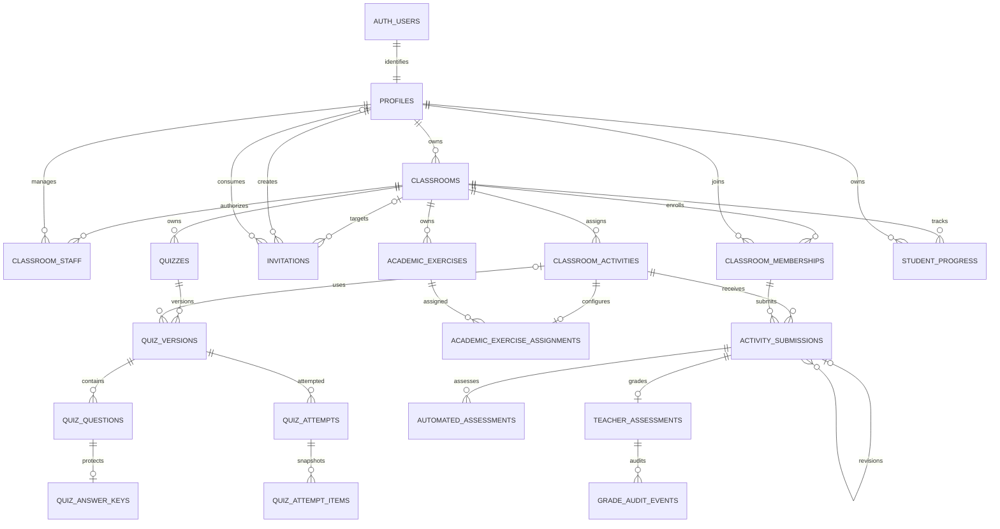

# Words Connect — Final Supabase Database Architecture

**Status:** Approved architecture; migration package prepared but unapplied.
**Product boundary:** One classroom is one independent group. There is no classroom-to-sections hierarchy. A teacher may own multiple classrooms.

The previous Express/MongoDB recommendation in [PROPOSED_ARCHITECTURE.md](PROPOSED_ARCHITECTURE.md) is superseded for backend storage and authorization. This document and `supabase/migrations/` define the Supabase proposal. No project URL, API key, service-role key, frontend integration, or data import is included here.

## Confirmed product rules

- Students can have memberships in multiple classrooms.
- Removing a student retains their membership and records. They keep read-only access to their own work and permitted historical information, but cannot perform new classroom writes. An authorized invitation or teacher action is required to reactivate membership.
- Each classroom has exactly one persistent Appreciation Wall activity instance. Its submissions can receive official marks.
- Appreciation Wall, Message Remix, and Academic Transfer are eligible graded activity types. Pit Stop is formative and never enters official grades or rankings.
- Revisions are supported only for Academic Transfer. A revision is an immutable version of one original attempt, not a separate activity.
- An archived classroom retains all data and settings. Students and teachers have read-only access to their permitted history. Grade marks, feedback, and audit records cannot be changed while archived; reopening the same classroom restores grading access without replacing records.
- Official rankings include a student with at least one eligible activity instance that has a reviewed mark. An incomplete set of reviewed activities does not exclude the student. Pending work is ignored.
- When at least three students qualify, the revealed student-facing Top 3 contains exactly three awardees; fewer than three eligible students are all shown.
- Reopening changes the same classroom row back to open. It never copies or duplicates records and does not overwrite settings.

## 1. Final ERD



`AUTH_USERS` is Supabase `auth.users`. One `classrooms` row represents one classroom/section. `classroom_activities` are assignments inside that classroom, not additional sections.

## 2. Complete table specification

All primary keys are UUIDs unless specified. All timestamps are `timestamptz`. Classroom-scoped rows include `classroom_id`; composite foreign keys prevent cross-classroom references. Status/type columns use text `CHECK` constraints in this initial schema to make future additions easier than changing PostgreSQL enums.

### Identity and access

| Table | Columns and constraints |
|---|---|
| `profiles` | `id uuid PK FK auth.users(id) ON DELETE RESTRICT`; `display_name text NOT NULL`; `email text NOT NULL`; `role text NOT NULL CHECK (role IN ('student','teacher','admin'))`; `status text NOT NULL CHECK (status IN ('pending','active','suspended'))`; `created_at`, `updated_at`. Unique index on `lower(email)`. Auth signup creates only a pending student profile; trusted invitation consumption activates/assigns the role. |
| `classrooms` | `id uuid PK`; `owner_teacher_id uuid NOT NULL FK profiles`; `name text NOT NULL CHECK (1–120 trimmed chars)`; `status text CHECK ('open','archived')`; `current_stage smallint CHECK (0–4)`; `wall_open`, `submissions_open`, `awards_revealed boolean NOT NULL`; `created_at`, `updated_at`, `archived_at`; check that archived status and non-null `archived_at` agree. Index `(owner_teacher_id,status,updated_at DESC)`. |
| `classroom_staff` | `classroom_id uuid FK classrooms`; `teacher_id uuid FK profiles`; `permission text CHECK ('manager','grader','viewer')`; `created_at`; PK `(classroom_id,teacher_id)`. Index `(teacher_id,classroom_id)`. Owner is implicitly manager. |
| `classroom_memberships` | `id uuid PK`; `classroom_id uuid FK classrooms`; `student_id uuid FK profiles`; `status text CHECK ('active','removed')`; `invitation_id uuid NULL FK invitations ON DELETE SET NULL`; `joined_at`, `ended_at`; unique `(classroom_id,student_id)` and `(classroom_id,id)`; check active iff `ended_at IS NULL`. Indexes `(student_id,status,classroom_id)` and `(classroom_id,status,student_id)`. Reuse/reactivate the same row; do not delete to remove a student. |
| `invitations` | `id uuid PK`; `classroom_id uuid NULL FK classrooms`; `intended_role text CHECK ('student','teacher')`; optional email; `token_hash text UNIQUE NOT NULL`; `status text CHECK ('pending','consumed','revoked','expired')`; `created_by uuid FK profiles`; `expires_at`; nullable `consumed_by uuid FK profiles`, `consumed_at`, `revoked_at`; `created_at`. Student invites require a classroom; teacher invites have no classroom and require an email. Unique token-hash index and partial indexes for pending classroom/expiry and normalized email/status. Raw token is never stored or selectable. |

### Activities and content

| Table | Columns and constraints |
|---|---|
| `classroom_activities` | `id uuid PK`; `classroom_id uuid FK classrooms`; `activity_type text CHECK ('appreciation','message-remix','academic-transfer','pit-stop')`; `title text`; `status text CHECK ('draft','open','closed','retired')`; `position integer`; optional `prompt_snapshot`; nullable `quiz_version_id`; `created_by uuid FK profiles`; timestamps; unique `(classroom_id,id)`. Composite FK `(classroom_id,quiz_version_id)` → `quiz_versions(classroom_id,id)`. Check: Pit Stop requires a quiz version, every non-Pit-Stop type requires it to be NULL. A validation trigger requires the referenced version to be published. Partial unique index `(classroom_id) WHERE activity_type='appreciation'` enforces exactly one persistent wall instance, including retired records. Index `(classroom_id,status,position)`. |
| `quizzes` | `id uuid PK`; `classroom_id uuid FK classrooms`; `title text`; `created_by uuid FK profiles`; `created_at`; unique `(classroom_id,id)`. |
| `quiz_versions` | `id uuid PK`; `classroom_id uuid`; `quiz_id uuid`; `version_number integer CHECK (>0)`; `status text CHECK ('draft','published','retired')`; `created_by uuid FK profiles`; `created_at`, nullable `published_at`; unique `(quiz_id,version_number)` and `(classroom_id,id)`; composite FK `(classroom_id,quiz_id)` → `quizzes(classroom_id,id)`; check draft iff `published_at IS NULL`. Index `(classroom_id,status)`. Drafts are editable; published/retired versions are immutable. Multiple published versions may coexist and be assigned to different activity instances. |
| `quiz_questions` | `id uuid PK`; `classroom_id uuid`; `quiz_version_id uuid`; `position integer CHECK (>=0)`; `title`, `prompt`; `options jsonb` array with at least two nonempty strings; `feedback jsonb` array; `created_at`; unique `(quiz_version_id,position)` and `(classroom_id,id)`; composite FK to quiz version. Index `(quiz_version_id,position)`. A trigger blocks edits/deletes after the version leaves draft. |
| `quiz_answer_keys` | `question_id uuid PK`; `classroom_id uuid`; `correct_option_index smallint CHECK (>=0)`; composite FK `(classroom_id,question_id)` → questions. Trigger validates index against options. RLS exposes this table to authorized graders/managers only. |
| `academic_exercises` | `id uuid PK`; `classroom_id uuid FK classrooms`; `exercise_family_id uuid`; `version_number integer CHECK (>0)`; `title`, `source_sentence`; `status text CHECK ('active','retired')`; `created_by uuid FK profiles`; `created_at`; unique `(classroom_id,exercise_family_id,version_number)` and `(classroom_id,id)`. Index `(classroom_id,status)`. Content versions are immutable; edits create the next version in the family. |
| `academic_exercise_assignments` | `id uuid PK`; `classroom_id uuid`; `activity_instance_id uuid UNIQUE`; `exercise_id uuid`; `source_sentence_snapshot`, `exercise_title_snapshot`; `assigned_by uuid FK profiles`; `assigned_at`; unique `(classroom_id,id)`; composite FKs to classroom activity and exercise. Trigger checks activity type and exact snapshot against assigned exercise version. |

### Student state and work

| Table | Columns and constraints |
|---|---|
| `student_progress` | PK `(classroom_id,student_id)`; composite FK to membership; `current_stage smallint CHECK (0–4)`; nullable `assigned_source_submission_id`; `assigned_source_snapshot jsonb`; `updated_at`; composite FK to source submission in the same classroom. Stage is the student’s saved navigation position, not completion proof. Index `(classroom_id,current_stage)`. |
| `quiz_attempts` | `id uuid PK`; `classroom_id`, `student_id`, `activity_instance_id`, `quiz_version_id`; `attempt_number integer CHECK (>0)`; `status CHECK ('in_progress','completed')`; nullable `score integer`; `total integer CHECK (>=0)`; timestamps; unique `(activity_instance_id,student_id,attempt_number)` and `(classroom_id,id)`; composite FKs to membership, activity, and quiz version; score ≤ total; completed iff `completed_at` is non-null; in-progress scores are null. Indexes by classroom/student/recent and classroom/status. These scores are formative only. |
| `quiz_attempt_items` | `id uuid PK`; `classroom_id`; `attempt_id`; `question_id`; `position integer`; `question_snapshot jsonb` with presented text/options but no answer key; nullable `selected_option_index`, `is_correct`; unique `(attempt_id,position)` and `(attempt_id,question_id)`; composite FKs to attempt and question; selected answer and correctness are both null or both non-null. Index `(attempt_id,position)`. |
| `activity_submissions` | `id uuid PK`; `classroom_id`, `activity_instance_id`, `student_id`; `submission_kind CHECK ('original','revision')`; `attempt_number > 0`; `version_number > 0`; nullable `revision_of_submission_id`; required response and `author_name_snapshot`; nullable `recipient`, `prompt_snapshot`, `exercise_id`, `exercise_title_snapshot`, `source_submission_id`, `source_author_id`, `source_author_name_snapshot`, `source_text_snapshot`; `submitted_at`, `created_at`; unique `(classroom_id,id)` and `(activity_instance_id,student_id,attempt_number,version_number)`. Composite FKs to activity, membership, source/parent submission, and exercise keep relationships inside one classroom. Original rows have version 1 and no parent. Revisions point directly to an original row, share its activity instance/student/attempt, and have version >1. Indexes by student chronology, activity attempt/version, parent, and source. |

`activity_submissions` stores all written work, including wall messages, so the current mock’s duplicate wall-plus-submission representation is not repeated. Activity-specific validation is enforced in a trigger and trusted submit functions:

- **Appreciation:** Must use the unique Appreciation activity instance. Nonempty message is limited to 240 characters and two sentence fragments; recipient remains optional and is limited to 30 characters, matching current frontend validation.
- **Message Remix:** Must preserve source text and author-name snapshots. For a classroom source, the source must be another student’s Appreciation submission in the same classroom. Sample messages have snapshots but no classroom source ID.
- **Academic Transfer:** Must use the exercise assigned to that exact activity instance. The database copies the assignment’s source sentence and title into the submission snapshots.
- **Revision:** Only Academic Transfer. It must point to an original submission from the same student, classroom, and activity instance; revisions of revisions are rejected. The original prompt/exercise snapshots are copied. A revision is a later version of its attempt, not another activity.

### Assessments and ranking data

| Table | Columns and constraints |
|---|---|
| `automated_assessments` | `id uuid PK`; `classroom_id`, `submission_id`; `engine`, `rubric_version`; `score numeric(5,2) CHECK (0–100)`; `details jsonb`; `created_at`; composite FK to submission; unique `(submission_id,engine,rubric_version)`. Index `(submission_id,created_at DESC)`. This is indicative, not official. |
| `teacher_assessments` | `classroom_id`; `submission_id uuid PK`; nullable `official_mark numeric(5,2) CHECK (0–100)`; `feedback text`; `status CHECK ('pending','reviewed')`; nullable `reviewed_by uuid FK profiles`, `reviewed_at`; `updated_at`; composite FK to submission. Reviewed requires mark, reviewer, and time; pending has no reviewer/time. Created as pending when a submission arrives. |
| `grade_audit_events` | `id uuid PK`; `classroom_id`, `submission_id`; nullable actor profile; `actor_type CHECK ('teacher','admin','system')`; event type; `old_values`, `new_values jsonb`; `created_at`; composite FK to submission. Append only; no client update/delete. Index `(submission_id,created_at DESC)`. |

Official marks are maintained per submission version. Changes are audited in the same transaction. Automated assessments do not populate teacher marks and are never used for rankings.

### Deletion and retention rules

- Classroom, membership, quiz version, exercise version, activity submission, teacher assessment, and grade audit history use restrictive FKs. Archive or retire instead of hard delete.
- Auth profiles are suspended/anonymized rather than deleted when records reference them.
- Membership removal updates its status and `ended_at`; it does not delete the row.
- Published quiz content and assigned exercise versions remain immutable and retained.
- Draft quiz questions/answer keys may be deleted while their version is draft. There is no authenticated hard-delete path for historical work.
- Invitations can be revoked/expired while their audit metadata remains.

## 3. RLS and authorization

RLS is enabled on every application table. Helper functions use `SECURITY DEFINER` with a fixed safe `search_path`; they are not substitutes for table policies. Admin platform access does not automatically grant access to student coursework.

| Actor | Reads | Writes |
|---|---|---|
| Student with active membership | Own profile; classroom settings and published content; classroom Appreciation Wall; own progress, attempts, submissions, automated results, and reviewed teacher assessments. | Own stage/assignment through RPC; own quiz attempts through scoring RPCs; own submissions/revisions through validated submit RPCs while classroom/activity is open. Cannot write grade, role, answer key, membership, or settings. |
| Student with removed membership | Own prior progress, quiz snapshots, submissions, and assessments; permitted classroom history. They do not receive current classroom content or other students’ work in an open class. | None. Removed membership is insufficient for progress, quiz, or submission RPCs. |
| Student in archived classroom | Read-only historical access to own work and permitted classroom history. | None. |
| Classroom owner/manager | Full classroom reports, membership, content, controls, archive/reopen, rankings, and historical grades/audit records. | Classroom settings/content, authorized membership management, and grades while open; archive/reopen via functions. No grade writes while archived. Cannot rewrite published quiz versions or historical submissions. |
| Authorized grader | Classroom work, assessment reports, and historical grades/audit records. | Official marks/feedback through grade RPC while the classroom is open; cannot grade archived classrooms or manage owner/settings/content unless also manager. |
| Authorized viewer | Classroom reports according to staff access. | No grade or content writes. |
| Admin | Platform profiles/status and teacher invitations. | Provision/revoke teacher invites and suspend/restore accounts through trusted functions. No default classroom-content access. |

Policy details:

- Membership SELECT is allowed to the student themselves or classroom staff. Removed membership remains readable, but all write operations explicitly require an **active** membership, active account, and open classroom/activity.
- Students can read the wall while active, but cannot read peers’ Remix or Academic Transfer responses. A removed student can read their own historical rows; the source text needed for their own Remix remains embedded in its snapshot.
- Student quiz question views omit answer keys and unpublished drafts. Students can read published quiz versions (and retained non-draft versions in archived classrooms); the protected answer-key table is accessible only to graders/managers, while scoring functions read it for students.
- Students see only reviewed marks/feedback. Teacher audit events are available to authorized graders, not students.
- Admin policies cover platform management. Classroom access requires actual classroom ownership/staff authorization.
- Never put the service-role key in browser code. Keep service-role access in trusted deployment/Edge Function environments only.

### Trusted operations

1. **Invitation create/revoke/consume:** An Edge Function generates a high-entropy raw token and stores only its SHA-256 hex hash. `create_invitation` checks caller scope. `consume_invitation` locks the invite, validates hash/status/expiry/email/role/classroom, activates the profile, creates or reactivates membership, and consumes the token atomically. Teacher role is granted only by an admin-issued teacher invitation. Invitation responses never include the token hash.
2. **Quiz attempts:** `start_quiz_attempt` checks open activity, published version, active student membership, and serializes attempt numbering. It snapshots presented question/options. `save_quiz_attempt_answer` validates attempt ownership/question/option and calculates correctness from the protected key. `complete_quiz_attempt` requires every item answered and finalizes formative score. Completed attempts are immutable; future retakes create new attempts.
3. **Submissions:** `submit_classroom_activity` checks account, active membership, open classroom/activity, wall/submission controls, response constraints, and source provenance. Prompt/exercise/source snapshots are loaded from trusted records where possible. `submit_academic_revision` verifies an original Academic Transfer row, copies its provenance, and allocates its next version. No direct student table INSERT/UPDATE/DELETE is granted.
4. **Grades:** `set_teacher_assessment` checks owner/grader authority, locks and verifies an open classroom, validates 0–100 marks and reviewed-state requirements, updates the current assessment, and writes an audit event transactionally. A table trigger repeats the open-classroom check for every insert/update path, including privileged direct SQL; assessment deletion/truncation is prohibited. Authenticated users receive no direct assessment DML grants or write RLS policies. Audit rows reject update/delete/truncate and remain readable to graders in archived classrooms.
5. **Progress:** `set_student_stage` and `set_remix_assignment` check active membership and classroom state. Direct student progress writes are revoked.
6. **Archive:** `archive_classroom` and `reopen_classroom` update the same row. Archive blocks student writes without modifying wall/submission settings. Managers use the functions instead of direct status writes.

## 4. Official ranking calculation

Eligible activity types are exactly Appreciation Wall, Message Remix, and Academic Transfer. Pit Stop is excluded. A revision has the same `activity_instance_id` and `attempt_number` as its original Academic Transfer attempt, with a higher `version_number`.

For each student/activity instance, the calculation first filters to reviewed teacher assessments with marks, then picks the highest reviewed version within each attempt, then picks the highest-numbered attempt that has a reviewed version. Filtering pending rows first ensures that a newer pending attempt or revision never displaces an older reviewed one. One mark per activity instance enters the student’s average. A student with one or more reviewed eligible instances is included; unreviewed/missing instances do not count as zero.

Equivalent query shape:

```sql
WITH reviewed AS (
  SELECT s.classroom_id, s.student_id, s.activity_instance_id, a.activity_type,
         s.attempt_number, s.version_number, s.submitted_at,
         ta.official_mark,
         row_number() OVER (
           PARTITION BY s.classroom_id, s.student_id,
                        s.activity_instance_id, s.attempt_number
           ORDER BY s.version_number DESC, s.submitted_at DESC, s.id
         ) AS version_choice
  FROM activity_submissions s
  JOIN classroom_activities a
    ON a.classroom_id = s.classroom_id AND a.id = s.activity_instance_id
  JOIN teacher_assessments ta
    ON ta.classroom_id = s.classroom_id AND ta.submission_id = s.id
  WHERE s.classroom_id = :classroom_id
    AND a.activity_type IN ('appreciation','message-remix','academic-transfer')
    AND ta.status = 'reviewed' AND ta.official_mark IS NOT NULL
), latest_version_per_attempt AS (
  SELECT * FROM reviewed WHERE version_choice = 1
), latest_reviewed_attempt AS (
  SELECT v.*,
         row_number() OVER (
           PARTITION BY v.classroom_id, v.student_id, v.activity_instance_id
           ORDER BY v.attempt_number DESC, v.submitted_at DESC, v.version_number DESC
         ) AS attempt_choice
  FROM latest_version_per_attempt v
), per_student AS (
  SELECT student_id, round(avg(official_mark), 2) AS official_average,
         count(*) AS reviewed_activity_count,
         avg(official_mark) FILTER (WHERE activity_type = 'academic-transfer')
           AS academic_transfer_average,
         max(submitted_at) AS latest_qualifying_submission_at
  FROM latest_reviewed_attempt
  WHERE attempt_choice = 1
  GROUP BY student_id
), ranked AS (
  SELECT per_student.*,
         row_number() OVER (
           ORDER BY official_average DESC,
             reviewed_activity_count DESC,
             academic_transfer_average DESC NULLS LAST,
             latest_qualifying_submission_at ASC,
             student_id ASC
         ) AS rank_position
  FROM per_student
)
SELECT student_id, official_average, reviewed_activity_count, rank_position
FROM ranked
ORDER BY rank_position;
```

The implemented `get_classroom_rankings(classroom_id)` applies the same grouping. Teachers with classroom staff access can see the complete ranked result. Students receive no rows until `awards_revealed=true`; then they see exactly three students when at least three qualify, or every eligible student when fewer than three qualify. Automated scores and quiz scores are never joined into this calculation.

Ranking positions use `row_number()` with this exact deterministic order:

1. Higher official average, rounded to two decimal places.
2. Higher count of reviewed eligible activity instances.
3. Higher Academic Transfer average across the selected reviewed instances, compared at full numeric precision; students with no reviewed Academic Transfer mark sort after students with an Academic Transfer average (`NULLS LAST`).
4. Earlier timestamp of the student's latest qualifying reviewed submission (the maximum qualifying `submitted_at`, ordered ascending).
5. Student UUID ascending.

The student-facing result filters `rank_position <= 3`; ties at the third-place boundary are deterministically resolved and cannot increase the awardee count beyond three. If fewer than three students have reviewed eligible work, all are returned. The query first selects the latest reviewed version within each attempt, then the latest reviewed attempt per activity instance; pending revisions and attempts are ignored. Averages use only the selected reviewed marks.

## 5. Archive and restoration

- Archive sets `classrooms.status='archived'` and `archived_at`; it does not copy/delete rows or alter settings.
- Student read policies preserve their own historical submissions, revisions, quiz attempts, progress, and reviewed marks. New writes fail because active classroom status is also required.
- Authorized teachers retain read-only access to classroom reports, submissions, assessments, and grade audit history. The grade RPC and a table trigger reject insert/update attempts while archived; assessment delete/truncate is prohibited, authenticated clients have no direct DML grants/write policies, and audit rows reject update/delete/truncate. Archiving does not modify existing marks, feedback, or audit events.
- Reopen sets status to open and clears `archived_at`; prior settings and all records remain unchanged. The same grade RPC and trigger permit grading again after reopening. The Appreciation Wall unique constraint prevents creating a second wall during restore.
- Hard deletion of a classroom with history is not part of the normal application workflow.

## 6. Migration mapping and validation

Current data resides in browser keys such as `wc_frontend_mock_data_v2`, with v1 and backup values. User credentials and session data are stored separately. The client migration in `frontend/src/services/dataModel.js` is not a Supabase import and must not be treated as one.

| Local model | Target mapping |
|---|---|
| User records | Re-invite through Supabase Auth; map old IDs to Auth UUIDs; create `profiles`. Do not import local password digests or trust browser roles. |
| One root `classroom` plus `sections[]` | Convert every section, including archived entries, into one independent `classrooms` row. There is no target `sections` table. Use root teacher ID only after verifying ownership. |
| `section.studentIds` | `classroom_memberships`; cross-check progress, wall author, and submission ownership. A local `user.sectionId` pointer is not sufficient because it permits only one classroom. |
| Section settings | Classroom stage, wall/submission flags, reveal flag, and archived status/timestamp. Preserve archived settings exactly. |
| Section quiz | Quiz, version, questions, protected keys; assign its published version to the Pit Stop activity. |
| `pitCompleted` and saved answers | Formative `quiz_attempts` plus `quiz_attempt_items` containing the original question/options/selected answer snapshot. Do not create teacher marks. |
| Exercises and assigned exercise ID | Versioned `academic_exercises`, activity instance, and `academic_exercise_assignments` with exact prompt/title snapshot. |
| Wall posts and duplicate Appreciation submissions | Deduplicate by legacy record ID and import each post once as an Appreciation submission. The source mock contains both `wall[]` and an equivalent activity record. |
| Message Remix and Academic Transfer | Separate original attempt rows with source message or prompt/exercise snapshots. Preserve author/text and timestamp. |
| Revisions/history | Revision rows pointing to the original Academic Transfer attempt; preserve attempt ordering, revision order, prompt, response, and score. Reject or quarantine invalid/cross-student legacy relationships. |
| Automated results | `automated_assessments`, distinct from official marks. |
| Existing teacher grading state | Current `teacher_assessments`. Import only known reviewer/time. Record a legacy import audit event; do not invent missing historical grade-change events or reviewer identity. |
| Invitations | Revoke and reissue. Local raw tokens are not valid production invitations. |

### Import checklist

1. Export and retain raw local v2, v1, and backup JSON before cutover.
2. Build explicit legacy-ID → Auth UUID mappings and verify teacher ownership of every converted classroom.
3. Dry-run classroom conversion; assert one imported classroom per source section and no new parent hierarchy.
4. Reconcile membership conflicts and multiple classroom memberships with the owner; preserve removed/archived history.
5. Compare wall counts and content after deduplication; assert each source wall post appears exactly once.
6. Compare quiz version, question order, choices, answer keys, attempts, answers, and formative scores against snapshots.
7. Compare exercise assignment and source snapshots for every Academic Transfer submission.
8. Compare complete Remix/Academic Transfer responses, timestamps, revisions, and parent links; quarantine invalid revision links.
9. Compare automated result and teacher mark counts separately; ensure no Pit Stop score entered official assessment.
10. Validate pending/reviewed grade state and record unknown history as unknown, not fabricated.
11. Verify archived settings, reveal state, archive timestamp, wall uniqueness, and restoration without row duplication.
12. Test RLS as active student, removed student, unrelated student, owner, each staff permission, unrelated teacher, and admin.
13. Test ranking cases: pending newer attempt, reviewed older attempt, pending revision, reviewed revision, multiple eligible instances, and partial grading.
14. Retain export/rollback data until reconciliation is signed off. Re-invite users instead of copying credentials.

## 7. Ordered SQL migration plan

Prepared migrations are additive and ordered. No migration has been executed. Avoid destructive rollback after data is written; restore from a verified backup rather than dropping populated tables.

| Order | File | Purpose |
|---|---|---|
| 1 | `202611160001_identity_and_classrooms.sql` | Profiles/Auth bootstrap, classrooms, classroom staff, memberships, invitations, composite participant role checks, auth/access helpers, invitation consumption. |
| 2 | `202611160002_activities_quizzes_and_exercises.sql` | Quizzes/versions/questions/protected keys, classroom activity instances and required composite quiz-version FK, unique wall constraint, exercise versions/assignments, quiz attempt snapshots and trusted formative scoring operations. |
| 3 | `202611160003_progress_and_activity_submissions.sql` | Student progress, activity submissions, source/prompt snapshots, revisions, validation triggers, trusted stage/assignment/submission/revision operations. |
| 4 | `202611160004_assessment_audit_and_rankings.sql` | Automated results, official teacher grades, archived write guard, immutable grade audit events, grade update function, exact-three reveal-gated ranking function. |
| 5 | `202611160005_rls_invites_archive_and_realtime.sql` | RLS and least-privilege grants, invitation create/revoke, profile suspension/restore, default wall creation, archive/reopen operations, publication setup. |

SQL regression scripts are in `supabase/tests/`. They require explicit fixture IDs and must be run against a disposable Supabase project after applying these migrations; they were not run as part of package preparation.

Before applying to a Supabase project, use a disposable development project, review generated SQL with the implementer, and run policy/constraint/RPC integration tests. The files use the Supabase `authenticated` and `anon` roles and `auth.uid()`; they are not portable plain PostgreSQL scripts without Supabase Auth roles/schema.
